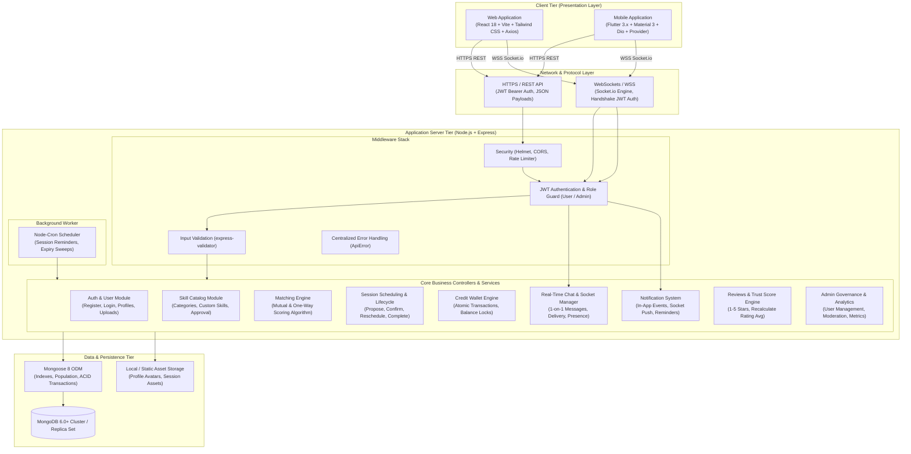
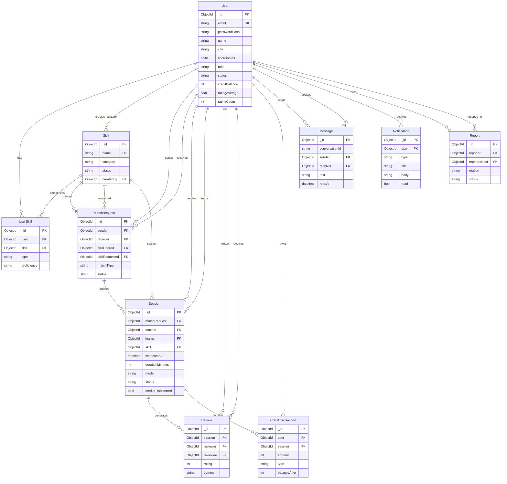
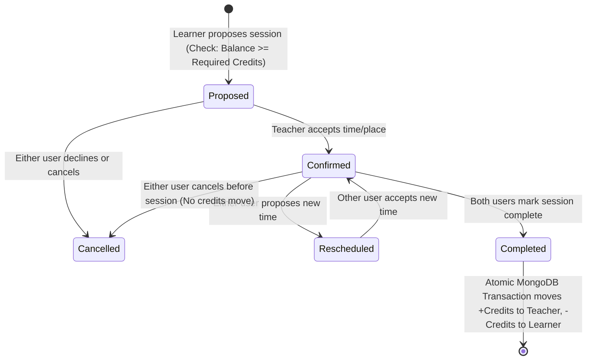

# Capstone Project Plan: Skill-Swap Platform

**Project Name:** Skill-Swap Platform  
**Target Architecture:** Monorepo (`/backend`, `/web`, `/mobile`, `/docs`)  
**Document Version:** 1.0.0 (Phase 0 Planning Milestone)  
**Author:** Senior Full-Stack Engineer  

---

## 1. System Architecture Diagram

The Skill-Swap Platform utilizes a modern client-server decoupled monorepo architecture. Clients (Vite React Web Application and Flutter Mobile Application) communicate with a unified Node.js / Express backend via REST API (stateless HTTPS requests) and Socket.io (bi-directional WebSockets for real-time messaging, typing indicators, user presence, and instant notifications).



---

## 2. Monorepo Folder Structure

The repository is organized cleanly into four top-level directories: `/backend`, `/web`, `/mobile`, and `/docs`.

```
skillswap/
├── backend/
│   ├── src/
│   │   ├── config/
│   │   │   ├── db.js                 # MongoDB connection & replica set check
│   │   │   ├── env.js                # Validated environment variables (dotenv)
│   │   │   └── swagger.js            # Swagger/OpenAPI 3.0 configuration
│   │   ├── constants/
│   │   │   ├── roles.js              # User roles ('user', 'admin')
│   │   │   ├── status.js             # Enums: session, request, report statuses
│   │   │   └── categories.js         # Standard skill categories
│   │   ├── controllers/
│   │   │   ├── authController.js     # Register, login, me, token refresh
│   │   │   ├── userController.js     # Profiles, avatar upload, public profiles
│   │   │   ├── skillController.js    # Catalog lookup, skill suggestions
│   │   │   ├── userSkillController.js# User teach/learn skill management
│   │   │   ├── matchController.js    # Ranked recommendations & match queries
│   │   │   ├── requestController.js  # Swap request lifecycle (send, accept, decline)
│   │   │   ├── sessionController.js  # Session scheduling, completion, cancellation
│   │   │   ├── walletController.js   # Credit balances and transaction logs
│   │   │   ├── messageController.js  # Conversation history and REST fallbacks
│   │   │   ├── notificationController.js # In-app notification management
│   │   │   ├── reviewController.js   # Post-session ratings and reviews
│   │   │   ├── reportController.js   # User safety and abuse reporting
│   │   │   └── adminController.js    # Moderation, analytics, user suspension
│   │   ├── middleware/
│   │   │   ├── auth.js               # JWT verification and user attachment
│   │   │   ├── role.js               # Role-based authorization guard
│   │   │   ├── validate.js           # express-validator result inspector
│   │   │   ├── rateLimiter.js        # Tiered IP rate limiters
│   │   │   ├── upload.js             # Multer setup for image uploads
│   │   │   └── errorHandler.js       # Centralized error handler + ApiError
│   │   ├── models/
│   │   │   ├── User.js               # User accounts, balances, ratings
│   │   │   ├── Skill.js              # Master skill catalog
│   │   │   ├── UserSkill.js          # Junction of User <-> Skill (Teach/Learn)
│   │   │   ├── MatchRequest.js       # Swap proposals between users
│   │   │   ├── Session.js            # Scheduled skill exchange sessions
│   │   │   ├── Message.js            # Chat messages
│   │   │   ├── Review.js             # Session reviews and ratings
│   │   │   ├── CreditTransaction.js  # Financial ledger for skill credits
│   │   │   ├── Notification.js       # In-app notification records
│   │   │   └── Report.js             # Moderation abuse reports
│   │   ├── routes/
│   │   │   ├── authRoutes.js
│   │   │   ├── userRoutes.js
│   │   │   ├── skillRoutes.js
│   │   │   ├── matchRoutes.js
│   │   │   ├── requestRoutes.js
│   │   │   ├── sessionRoutes.js
│   │   │   ├── walletRoutes.js
│   │   │   ├── messageRoutes.js
│   │   │   ├── notificationRoutes.js
│   │   │   ├── reviewRoutes.js
│   │   │   ├── reportRoutes.js
│   │   │   └── adminRoutes.js
│   │   ├── services/
│   │   │   ├── matchingService.js    # Multi-factor recommendation algorithm
│   │   │   ├── walletService.js      # ACID credit transfer & balance checking
│   │   │   ├── notificationService.js# DB notification writer + real-time emitter
│   │   │   ├── cronService.js        # Scheduled background tasks (reminders)
│   │   │   └── socketService.js      # Socket.io connection & room management
│   │   ├── sockets/
│   │   │   ├── socketHandler.js      # Socket auth and event hub
│   │   │   ├── chatEvents.js         # message:send, typing, read receipts
│   │   │   └── notificationEvents.js # Real-time alerts
│   │   ├── utils/
│   │   │   ├── ApiError.js           # Custom operational error class
│   │   │   ├── asyncHandler.js       # Async controller wrapper
│   │   │   └── helpers.js            # Geometry, distance & time calculations
│   │   ├── seed/
│   │   │   ├── skills.js             # 40+ curated initial skills
│   │   │   └── demo.js               # 20 users, complete history, admin user
│   │   ├── app.js                    # Express app initialization
│   │   └── server.js                 # HTTP + Socket.io server bootstrap
│   ├── tests/
│   │   ├── unit/
│   │   │   ├── matchingService.test.js # Match scoring unit tests
│   │   │   └── walletService.test.js   # Credit transaction unit tests
│   │   └── integration/
│   │       ├── auth.test.js
│   │       └── session.test.js
│   ├── uploads/                      # Storage for avatar images
│   ├── .env.example
│   ├── jest.config.js
│   ├── package.json
│   ├── requests.http                 # Ready-to-run REST test requests
│   └── README.md
│
├── web/
│   ├── public/
│   │   └── favicon.ico
│   ├── src/
│   │   ├── assets/                   # Logos, illustrations, placeholder avatars
│   │   ├── components/
│   │   │   ├── common/               # Design system primitives
│   │   │   │   ├── Button.jsx
│   │   │   │   ├── Input.jsx
│   │   │   │   ├── Select.jsx
│   │   │   │   ├── Card.jsx
│   │   │   │   ├── Modal.jsx
│   │   │   │   ├── Badge.jsx
│   │   │   │   ├── Avatar.jsx
│   │   │   │   ├── Toast.jsx
│   │   │   │   └── Skeleton.jsx
│   │   │   ├── layout/
│   │   │   │   ├── Navbar.jsx
│   │   │   │   ├── Sidebar.jsx
│   │   │   │   ├── Footer.jsx
│   │   │   │   └── ProtectedRoute.jsx
│   │   │   ├── features/
│   │   │   │   ├── matches/          # MatchCard, MatchFilterBar
│   │   │   │   ├── chat/             # ChatWindow, MessageBubble, TypingIndicator
│   │   │   │   ├── sessions/         # SessionCard, ProposeSessionModal, CalendarView
│   │   │   │   ├── skills/           # SkillTagInput, SkillSelectorModal
│   │   │   │   ├── wallet/           # CreditBalanceCard, TransactionTable
│   │   │   │   ├── reviews/          # ReviewFormModal, StarRating
│   │   │   │   └── admin/            # AnalyticsCharts, ModerationTable
│   │   ├── context/
│   │   │   ├── AuthContext.jsx       # User state, token lifecycle, login/logout
│   │   │   ├── SocketContext.jsx     # Socket.io connection, online users list
│   │   │   ├── NotificationContext.jsx # Real-time alerts, unread counts
│   │   │   └── ToastContext.jsx      # Global toast notification triggers
│   │   ├── hooks/
│   │   │   ├── useAuth.js
│   │   │   ├── useSocket.js
│   │   │   ├── useNotifications.js
│   │   │   └── useDebounce.js
│   │   ├── pages/
│   │   │   ├── LandingPage.jsx
│   │   │   ├── LoginPage.jsx
│   │   │   ├── RegisterPage.jsx
│   │   │   ├── DashboardPage.jsx
│   │   │   ├── DiscoverMatchesPage.jsx
│   │   │   ├── RequestsPage.jsx
│   │   │   ├── SessionsPage.jsx
│   │   │   ├── ChatPage.jsx
│   │   │   ├── ProfilePage.jsx
│   │   │   ├── WalletPage.jsx
│   │   │   ├── AdminDashboardPage.jsx
│   │   │   └── NotFoundPage.jsx
│   │   ├── services/
│   │   │   ├── api.js                # Axios instance with auth interceptor
│   │   │   ├── authService.js
│   │   │   ├── matchService.js
│   │   │   ├── sessionService.js
│   │   │   ├── chatService.js
│   │   │   ├── walletService.js
│   │   │   └── adminService.js
│   │   ├── utils/
│   │   │   ├── formatters.js         # Dates, durations, credit numbers
│   │   │   └── validators.js         # Form field validation rules
│   │   ├── App.jsx                   # Router & Context provider tree
│   │   ├── index.css                 # Tailwind directives & CSS variables
│   │   └── main.jsx
│   ├── index.html
│   ├── tailwind.config.js
│   ├── postcss.config.js
│   ├── vite.config.js
│   ├── package.json
│   └── README.md
│
├── mobile/
│   ├── lib/
│   │   ├── config/
│   │   │   ├── api_config.dart       # Base URLs (dynamic / configurable)
│   │   │   ├── app_theme.dart        # Material 3 theme colors & typography
│   │   │   └── routes.dart           # Named navigation route table
│   │   ├── models/
│   │   │   ├── user_model.dart
│   │   │   ├── skill_model.dart
│   │   │   ├── match_model.dart
│   │   │   ├── session_model.dart
│   │   │   ├── message_model.dart
│   │   │   └── transaction_model.dart
│   │   ├── providers/
│   │   │   ├── auth_provider.dart
│   │   │   ├── match_provider.dart
│   │   │   ├── session_provider.dart
│   │   │   ├── chat_provider.dart
│   │   │   └── wallet_provider.dart
│   │   ├── services/
│   │   │   ├── api_service.dart      # Dio HTTP client with interceptor
│   │   │   ├── storage_service.dart  # FlutterSecureStorage for JWT
│   │   │   └── socket_service.dart   # Socket.io client listener
│   │   ├── views/
│   │   │   ├── screens/
│   │   │   │   ├── splash_screen.dart
│   │   │   │   ├── login_screen.dart
│   │   │   │   ├── register_screen.dart
│   │   │   │   ├── home_screen.dart
│   │   │   │   ├── matches_screen.dart
│   │   │   │   ├── requests_screen.dart
│   │   │   │   ├── chat_list_screen.dart
│   │   │   │   ├── chat_room_screen.dart
│   │   │   │   ├── sessions_screen.dart
│   │   │   │   ├── wallet_screen.dart
│   │   │   │   ├── profile_screen.dart
│   │   │   │   └── rate_session_screen.dart
│   │   │   └── widgets/
│   │   │       ├── match_card.dart
│   │   │       ├── session_tile.dart
│   │   │       ├── custom_button.dart
│   │   │       ├── custom_text_field.dart
│   │   │       └── credit_badge.dart
│   │   └── main.dart
│   ├── pubspec.yaml
│   └── README.md
│
├── docs/
│   ├── PLAN.md                       # Master Architecture & Specs (Current document)
│   ├── TEST_CASES.md                 # Detailed Test Matrix & QA report
│   ├── REPORT.md                     # Final Capstone Project Report (11 Chapters)
│   └── VIVA_QA.md                    # 40 Technical Viva Q&A Guide
├── docker-compose.yml
└── README.md
```

---

## 3. MongoDB Schemas & Data Model Specifications

The database consists of 10 collections designed for relational integrity, high query efficiency, and transactional safety.

### 3.1 Collection: `users`
Stores user profile credentials, availability, location, credit balances, and aggregated ratings.

```javascript
{
  _id: ObjectId,
  name: { type: String, required: true, trim: true },
  email: { type: String, required: true, unique: true, lowercase: true, index: true },
  passwordHash: { type: String, required: true },
  bio: { type: String, default: '', maxlength: 1000 },
  location: {
    city: { type: String, required: true, trim: true, index: true },
    country: { type: String, default: '' },
    coordinates: {
      type: { type: String, enum: ['Point'], default: 'Point' },
      coordinates: { type: [Number], default: [0, 0] } // [lng, lat]
    }
  },
  availability: [
    {
      dayOfWeek: { type: String, enum: ['Monday', 'Tuesday', 'Wednesday', 'Thursday', 'Friday', 'Saturday', 'Sunday'], required: true },
      slots: [
        {
          startTime: { type: String, required: true }, // "09:00" (24h)
          endTime: { type: String, required: true }     // "11:00"
        }
      ]
    }
  ],
  photoUrl: { type: String, default: '' },
  role: { type: String, enum: ['user', 'admin'], default: 'user', index: true },
  status: { type: String, enum: ['active', 'suspended'], default: 'active', index: true },
  creditBalance: { type: Number, default: 2, min: 0 }, // 2 initial free credits
  ratingAverage: { type: Number, default: 0, min: 0, max: 5 },
  ratingCount: { type: Number, default: 0, min: 0 },
  lastActiveAt: { type: Date, default: Date.now },
  createdAt: Date,
  updatedAt: Date
}
```
*Indexes:*
- `email`: 1 (Unique)
- `location.city`: 1
- `role`: 1
- `status`: 1
- `location.coordinates`: '2dsphere'

---

### 3.2 Collection: `skills`
Master catalog of standardized and community-suggested skills.

```javascript
{
  _id: ObjectId,
  name: { type: String, required: true, unique: true, trim: true },
  category: { 
    type: String, 
    required: true, 
    enum: ['Music', 'Cooking', 'Coding', 'Languages', 'Sports', 'Art', 'Academics', 'Other'],
    index: true 
  },
  description: { type: String, default: '' },
  status: { type: String, enum: ['approved', 'pending'], default: 'pending', index: true },
  createdBy: { type: ObjectId, ref: 'User', default: null },
  createdAt: Date,
  updatedAt: Date
}
```
*Indexes:*
- `name`: 1 (Unique, Case-Insensitive collation)
- `category`: 1
- `status`: 1

---

### 3.3 Collection: `userSkills`
Junction collection connecting users to skills they TEACH or want to LEARN.

```javascript
{
  _id: ObjectId,
  user: { type: ObjectId, ref: 'User', required: true, index: true },
  skill: { type: ObjectId, ref: 'Skill', required: true, index: true },
  type: { type: String, enum: ['TEACH', 'LEARN'], required: true, index: true },
  proficiency: { type: String, enum: ['Beginner', 'Intermediate', 'Expert'], default: 'Intermediate' },
  description: { type: String, default: '', maxlength: 500 },
  createdAt: Date,
  updatedAt: Date
}
```
*Indexes:*
- Compound Unique Index: `{ user: 1, skill: 1, type: 1 }` (Ensures a user cannot add the same skill twice in the same direction)
- `{ type: 1, skill: 1 }`: Optimized index for reverse matching queries

---

### 3.4 Collection: `matchRequests`
Tracks swap invitations sent between users.

```javascript
{
  _id: ObjectId,
  sender: { type: ObjectId, ref: 'User', required: true, index: true },
  receiver: { type: ObjectId, ref: 'User', required: true, index: true },
  skillOffered: { type: ObjectId, ref: 'Skill', default: null }, // Nullable for pure credit-based one-way learning
  skillRequested: { type: ObjectId, ref: 'Skill', required: true },
  matchType: { type: String, enum: ['MUTUAL', 'ONE_WAY'], required: true },
  status: { type: String, enum: ['pending', 'accepted', 'declined', 'cancelled'], default: 'pending', index: true },
  message: { type: String, default: '', maxlength: 500 },
  respondedAt: { type: Date, default: null },
  createdAt: Date,
  updatedAt: Date
}
```
*Indexes:*
- Compound Index: `{ sender: 1, receiver: 1, status: 1 }`
- `{ receiver: 1, status: 1 }`

---

### 3.5 Collection: `sessions`
Represents an agreed learning session. Tracks date, duration, confirmation, and dual-completion flags.

```javascript
{
  _id: ObjectId,
  matchRequest: { type: ObjectId, ref: 'MatchRequest', required: true, index: true },
  teacher: { type: ObjectId, ref: 'User', required: true, index: true },
  learner: { type: ObjectId, ref: 'User', required: true, index: true },
  skill: { type: ObjectId, ref: 'Skill', required: true },
  scheduledAt: { type: Date, required: true, index: true },
  durationMinutes: { type: Number, required: true, default: 60, min: 15, max: 240 },
  mode: { type: String, enum: ['online', 'offline'], required: true },
  meetingLink: { type: String, default: '' },
  locationAddress: { type: String, default: '' },
  status: { 
    type: String, 
    enum: ['proposed', 'confirmed', 'rescheduled', 'cancelled', 'completed'], 
    default: 'proposed',
    index: true 
  },
  completionConfirmation: {
    teacherConfirmed: { type: Boolean, default: false },
    learnerConfirmed: { type: Boolean, default: false },
    teacherConfirmedAt: { type: Date, default: null },
    learnerConfirmedAt: { type: Date, default: null }
  },
  creditsTransferred: { type: Boolean, default: false },
  reminderSent: { type: Boolean, default: false },
  createdAt: Date,
  updatedAt: Date
}
```
*Indexes:*
- `{ teacher: 1, scheduledAt: 1 }`
- `{ learner: 1, scheduledAt: 1 }`
- `{ status: 1, scheduledAt: 1 }`

---

### 3.6 Collection: `messages`
Chat messages exchanged between two matched users.

```javascript
{
  _id: ObjectId,
  conversationId: { type: String, required: true, index: true }, // Format: min(userA, userB)_max(userA, userB)
  sender: { type: ObjectId, ref: 'User', required: true, index: true },
  receiver: { type: ObjectId, ref: 'User', required: true, index: true },
  text: { type: String, required: true, trim: true, maxlength: 2000 },
  readAt: { type: Date, default: null },
  createdAt: { type: Date, default: Date.now, index: true },
  updatedAt: Date
}
```
*Indexes:*
- Compound Index: `{ conversationId: 1, createdAt: -1 }`
- `{ receiver: 1, readAt: 1 }`

---

### 3.7 Collection: `reviews`
Post-session ratings (1 to 5 stars) and comments. Recalculates recipient's aggregate score upon insertion.

```javascript
{
  _id: ObjectId,
  session: { type: ObjectId, ref: 'Session', required: true, index: true },
  reviewer: { type: ObjectId, ref: 'User', required: true, index: true },
  reviewee: { type: ObjectId, ref: 'User', required: true, index: true },
  rating: { type: Number, required: true, min: 1, max: 5 },
  comment: { type: String, default: '', maxlength: 1000 },
  createdAt: Date,
  updatedAt: Date
}
```
*Indexes:*
- Compound Unique Index: `{ session: 1, reviewer: 1 }` (Strictly one review per party per session)
- `{ reviewee: 1, rating: -1 }`

---

### 3.8 Collection: `creditTransactions`
Double-entry immutable audit ledger for every credit movement.

```javascript
{
  _id: ObjectId,
  user: { type: ObjectId, ref: 'User', required: true, index: true },
  session: { type: ObjectId, ref: 'Session', default: null, index: true },
  amount: { type: Number, required: true }, // e.g. +1 or -1
  type: { 
    type: String, 
    enum: ['BONUS', 'EARN', 'SPEND', 'REFUND', 'ADMIN_ADJUST'], 
    required: true,
    index: true 
  },
  balanceAfter: { type: Number, required: true },
  description: { type: String, required: true },
  createdAt: { type: Date, default: Date.now, index: true }
}
```
*Indexes:*
- Compound Index: `{ user: 1, createdAt: -1 }`
- `{ type: 1, createdAt: -1 }`

---

### 3.9 Collection: `notifications`
In-app alerts and real-time push records.

```javascript
{
  _id: ObjectId,
  user: { type: ObjectId, ref: 'User', required: true, index: true }, // Target recipient
  sender: { type: ObjectId, ref: 'User', default: null },
  type: { 
    type: String, 
    enum: [
      'MATCH_REQUEST', 
      'REQUEST_ACCEPTED', 
      'REQUEST_DECLINED', 
      'NEW_MESSAGE', 
      'SESSION_PROPOSED', 
      'SESSION_CONFIRMED', 
      'SESSION_CANCELLED', 
      'SESSION_REMINDER', 
      'SESSION_COMPLETED', 
      'NEW_REVIEW', 
      'CREDIT_EARNED', 
      'CREDIT_SPENT'
    ], 
    required: true 
  },
  title: { type: String, required: true },
  body: { type: String, required: true },
  link: { type: String, default: '' }, // Frontend destination route
  metadata: { type: Object, default: {} }, // Reference IDs (session, request, etc.)
  read: { type: Boolean, default: false, index: true },
  readAt: { type: Date, default: null },
  createdAt: { type: Date, default: Date.now, index: true }
}
```
*Indexes:*
- Compound Index: `{ user: 1, read: 1, createdAt: -1 }`

---

### 3.10 Collection: `reports`
User moderation, abuse flagging, and dispute records.

```javascript
{
  _id: ObjectId,
  reporter: { type: ObjectId, ref: 'User', required: true, index: true },
  reportedUser: { type: ObjectId, ref: 'User', required: true, index: true },
  reason: { 
    type: String, 
    enum: ['INAPPROPRIATE_BEHAVIOR', 'NO_SHOW', 'HARASSMENT', 'SPAM', 'FRAUD', 'OTHER'], 
    required: true 
  },
  details: { type: String, required: true, maxlength: 2000 },
  status: { type: String, enum: ['open', 'investigating', 'resolved', 'dismissed'], default: 'open', index: true },
  resolutionNotes: { type: String, default: '' },
  resolvedBy: { type: ObjectId, ref: 'User', default: null },
  createdAt: Date,
  updatedAt: Date
}
```
*Indexes:*
- `{ status: 1, createdAt: -1 }`
- `{ reportedUser: 1 }`

---

## 4. Entity-Relationship (ER) Diagram

The following Mermaid ER diagram illustrates all entities, foreign key references, and relationship cardinalities:



---

## 5. Full REST API Specification

All protected endpoints require the HTTP Authorization header: `Authorization: Bearer <JWT_ACCESS_TOKEN>`.

### 5.1 Authentication Module (`/api/auth`)
| Method | Path | Auth | Purpose | Request Body / Query | Response Code |
| :--- | :--- | :--- | :--- | :--- | :--- |
| `POST` | `/api/auth/register` | Public | Register new user (grants 2 credits) | `{ name, email, password, city, availability? }` | 201 Created |
| `POST` | `/api/auth/login` | Public | Authenticate user & return JWT | `{ email, password }` | 200 OK |
| `GET` | `/api/auth/me` | User | Get current logged-in user profile & credits | None | 200 OK |
| `POST` | `/api/auth/logout` | User | Invalidate session client-side | None | 200 OK |

### 5.2 User Management Module (`/api/users`)
| Method | Path | Auth | Purpose | Request Body / Query | Response Code |
| :--- | :--- | :--- | :--- | :--- | :--- |
| `GET` | `/api/users/me` | User | Get detailed personal profile | None | 200 OK |
| `PUT` | `/api/users/me` | User | Update personal profile (bio, city, availability) | `{ bio, location, availability }` | 200 OK |
| `POST` | `/api/users/me/photo` | User | Upload avatar photo (multipart/form-data) | `FormData(photo: File)` | 200 OK |
| `GET` | `/api/users/:id` | Public | View public profile of a user (ratings, skills) | None | 200 OK |
| `GET` | `/api/users/search` | Public | Search users by skill name, type (teach/learn), city | `?skill=&type=&location=&page=&limit=` | 200 OK |

### 5.3 Skill Catalog Module (`/api/skills` & `/api/users/me/skills`)
| Method | Path | Auth | Purpose | Request Body / Query | Response Code |
| :--- | :--- | :--- | :--- | :--- | :--- |
| `GET` | `/api/skills` | Public | List approved catalog skills with search & category filter | `?search=&category=&page=&limit=` | 200 OK |
| `POST` | `/api/skills` | User | Propose a new custom skill (sets status to 'pending') | `{ name, category, description }` | 201 Created |
| `GET` | `/api/users/me/skills` | User | Get current user's teach and learn skill lists | None | 200 OK |
| `POST` | `/api/users/me/skills` | User | Add a skill to teach or learn list | `{ skillId, type, proficiency, description }` | 201 Created |
| `PUT` | `/api/users/me/skills/:id`| User | Update proficiency or description of a user skill | `{ proficiency, description }` | 200 OK |
| `DELETE`| `/api/users/me/skills/:id`| User | Remove a skill from user's profile | None | 200 OK |

### 5.4 Matching Engine Module (`/api/matches`)
| Method | Path | Auth | Purpose | Request Body / Query | Response Code |
| :--- | :--- | :--- | :--- | :--- | :--- |
| `GET` | `/api/matches` | User | Retrieve ranked match suggestions with breakdown scores | `?mode=all&category=&city=&page=&limit=` | 200 OK |
| `GET` | `/api/matches/:targetUserId`| User | Inspect detailed match score & factor breakdown with another user | None | 200 OK |

### 5.5 Swap Requests Module (`/api/requests`)
| Method | Path | Auth | Purpose | Request Body / Query | Response Code |
| :--- | :--- | :--- | :--- | :--- | :--- |
| `POST` | `/api/requests` | User | Send a swap proposal (Mutual or One-Way Credit) | `{ receiverId, skillRequestedId, skillOfferedId?, matchType, message }` | 201 Created |
| `GET` | `/api/requests` | User | Get user's requests (`?type=received` or `?type=sent`) | `?type=received&status=pending` | 200 OK |
| `PATCH`| `/api/requests/:id/accept` | User | Accept incoming swap request | None | 200 OK |
| `PATCH`| `/api/requests/:id/decline`| User | Decline incoming swap request | None | 200 OK |
| `PATCH`| `/api/requests/:id/cancel` | User | Cancel sent pending swap request | None | 200 OK |

### 5.6 Sessions Scheduling Module (`/api/sessions`)
| Method | Path | Auth | Purpose | Request Body / Query | Response Code |
| :--- | :--- | :--- | :--- | :--- | :--- |
| `POST` | `/api/sessions` | User | Propose a new session (checks credit balance) | `{ matchRequestId, scheduledAt, durationMinutes, mode, meetingLink?, locationAddress? }` | 201 Created |
| `GET` | `/api/sessions` | User | List user sessions (filter by upcoming/completed/past) | `?status=confirmed&timeframe=upcoming` | 200 OK |
| `GET` | `/api/sessions/:id` | User | Get details of a single session | None | 200 OK |
| `PATCH`| `/api/sessions/:id/confirm` | User | Confirm proposed/rescheduled session | None | 200 OK |
| `PATCH`| `/api/sessions/:id/reschedule`| User | Propose alternative date/time for session | `{ scheduledAt }` | 200 OK |
| `PATCH`| `/api/sessions/:id/cancel` | User | Cancel a session | `{ reason? }` | 200 OK |
| `PATCH`| `/api/sessions/:id/complete` | User | Mark session as completed (triggers atomic transfer when both agree) | None | 200 OK |

### 5.7 Credit Wallet Module (`/api/wallet`)
| Method | Path | Auth | Purpose | Request Body / Query | Response Code |
| :--- | :--- | :--- | :--- | :--- | :--- |
| `GET` | `/api/wallet` | User | Get current credit balance and ledger transactions | `?page=1&limit=20` | 200 OK |

### 5.8 Real-Time Chat & Messages Module (`/api/conversations`)
| Method | Path | Auth | Purpose | Request Body / Query | Response Code |
| :--- | :--- | :--- | :--- | :--- | :--- |
| `GET` | `/api/conversations` | User | List all active conversation threads with last message | None | 200 OK |
| `GET` | `/api/conversations/:targetUserId/messages` | User | Get message history with target user (paginated) | `?page=1&limit=50` | 200 OK |
| `POST` | `/api/conversations/:targetUserId/messages` | User | REST fallback for sending chat message | `{ text }` | 201 Created |
| `PATCH`| `/api/conversations/:targetUserId/read` | User | Mark messages from user as read | None | 200 OK |

### 5.9 Notifications Module (`/api/notifications`)
| Method | Path | Auth | Purpose | Request Body / Query | Response Code |
| :--- | :--- | :--- | :--- | :--- | :--- |
| `GET` | `/api/notifications` | User | Get user notifications list | `?read=&page=&limit=` | 200 OK |
| `PATCH`| `/api/notifications/:id/read` | User | Mark single notification as read | None | 200 OK |
| `PATCH`| `/api/notifications/read-all` | User | Mark all notifications as read | None | 200 OK |

### 5.10 Reviews & Ratings Module (`/api/reviews`)
| Method | Path | Auth | Purpose | Request Body / Query | Response Code |
| :--- | :--- | :--- | :--- | :--- | :--- |
| `POST` | `/api/reviews` | User | Post 1-5 star review after completed session | `{ sessionId, rating, comment }` | 201 Created |
| `GET` | `/api/users/:userId/reviews` | Public | Get public review list for a user | `?page=&limit=` | 200 OK |

### 5.11 Safety & Reports Module (`/api/reports`)
| Method | Path | Auth | Purpose | Request Body / Query | Response Code |
| :--- | :--- | :--- | :--- | :--- | :--- |
| `POST` | `/api/reports` | User | Report user for misconduct/no-show | `{ reportedUserId, reason, details }` | 201 Created |

### 5.12 Admin Governance Module (`/api/admin`)
| Method | Path | Auth | Purpose | Request Body / Query | Response Code |
| :--- | :--- | :--- | :--- | :--- | :--- |
| `GET` | `/api/admin/analytics` | Admin | Aggregate dashboard metrics (users, sessions, credits) | None | 200 OK |
| `GET` | `/api/admin/users` | Admin | Search/filter all users (view credits, status) | `?search=&role=&status=&page=&limit=` | 200 OK |
| `PATCH`| `/api/admin/users/:id/status` | Admin | Suspend or reactivate user | `{ status: 'active' \| 'suspended' }` | 200 OK |
| `GET` | `/api/admin/skills/pending`| Admin | List custom skills awaiting approval | None | 200 OK |
| `PATCH`| `/api/admin/skills/:id/approve` | Admin | Approve or reject custom skill | `{ status: 'approved' \| 'rejected' }` | 200 OK |
| `GET` | `/api/admin/reports` | Admin | List moderation abuse reports | `?status=open` | 200 OK |
| `PATCH`| `/api/admin/reports/:id` | Admin | Update status of moderation report | `{ status, resolutionNotes }` | 200 OK |

---

## 6. Matching Algorithm Design & Scoring Formula

The matching engine recommends potential partners to User $A$ by comparing their skills, location, availability, ratings, and proficiency levels against all other active users in the system.

### 6.1 Mathematical Formulation

Let User $A$ be the querying user and User $B$ be a candidate user. The overall Match Score $S(A, B) \in [0, 100]$ is computed as:

$$S(A, B) = \min(100, \, S_{\text{base}} + B_{\text{location}} + B_{\text{availability}} + B_{\text{rating}} + B_{\text{proficiency}})$$

#### 1. Base Score ($S_{\text{base}}$)
Determined by complementary skill overlap:
*   **Mutual Match ($S_{\text{base}} = 50$ to $60$):**
    User $A$ teaches a skill User $B$ wants to learn AND User $B$ teaches a skill User $A$ wants to learn:
    $$S_{\text{base}} = 60$$
*   **One-Way Match ($S_{\text{base}} = 30$):**
    User $B$ teaches a skill User $A$ wants to learn, but User $A$ does not teach anything User $B$ has listed (requires skill credits):
    $$S_{\text{base}} = 30$$
*   **No Skill Alignment:**
    If User $B$ teaches nothing User $A$ wants to learn, $S(A, B) = 0$ (filtered out of recommendations).

#### 2. Location Proximity Bonus ($B_{\text{location}} \in [0, 15]$)
*   If both users share the exact same city: $+15 \text{ points}$.
*   If geo-coordinates are present:
    *   Distance $\le 10 \text{ km}$: $+15 \text{ points}$
    *   $10 \text{ km} < \text{Distance} \le 25 \text{ km}$: $+10 \text{ points}$
    *   $25 \text{ km} < \text{Distance} \le 50 \text{ km}$: $+5 \text{ points}$
    *   $\text{Distance} > 50 \text{ km}$ or different cities: $+0 \text{ points}$

#### 3. Availability Overlap Bonus ($B_{\text{availability}} \in [0, 15]$)
Users specify availability as weekly time windows (Day + Time Slots).
Overlap is calculated by intersecting day and time slots between User $A$ and User $B$:
$$\text{Overlapping Slots} = |\{ (d, s_A) \cap (d, s_B) \}|$$
*   $\ge 3 \text{ matching overlapping slots}$: $+15 \text{ points}$
*   $2 \text{ matching overlapping slots}$: $+10 \text{ points}$
*   $1 \text{ matching overlapping slot}$: $+5 \text{ points}$
*   $0 \text{ overlapping slots}$: $+0 \text{ points}$

#### 4. Reputation / Rating Bonus ($B_{\text{rating}} \in [0, 10]$)
Derived from Candidate $B$'s average review score $R_B$:
*   $R_B \ge 4.8$: $+10 \text{ points}$
*   $4.5 \le R_B < 4.8$: $+8 \text{ points}$
*   $4.0 \le R_B < 4.5$: $+6 \text{ points}$
*   $3.5 \le R_B < 4.0$: $+4 \text{ points}$
*   New user ($R_B = 0$, $0 \text{ reviews}$): $+5 \text{ points}$ (Fairness boost for new members)
*   $R_B < 3.5$: $+0 \text{ points}$

#### 5. Proficiency Fit Bonus ($B_{\text{proficiency}} \in [0, 10]$)
Compares learner desired level against teacher proficiency:
*   Learner is **Beginner** & Teacher is **Expert** or **Intermediate**: $+10 \text{ points}$
*   Learner is **Intermediate** & Teacher is **Expert**: $+10 \text{ points}$
*   Learner is **Intermediate** & Teacher is **Intermediate**: $+7 \text{ points}$
*   Learner is **Expert** & Teacher is **Expert**: $+8 \text{ points}$
*   Other combinations: $+3 \text{ points}$

### 6.2 Human-Readable Explanation Builder
The API response pairs every candidate with a dynamic explanation breakdown:
```json
{
  "user": {
    "_id": "651a2f...",
    "name": "Sarah Connor",
    "city": "Austin",
    "ratingAverage": 4.9
  },
  "score": 95,
  "matchType": "MUTUAL",
  "explanation": {
    "summary": "Perfect Mutual Match! You can exchange skills directly.",
    "teachesYou": ["Guitar (Expert)"],
    "learnsFromYou": ["Python Programming (Intermediate)"],
    "factors": [
      { "name": "Mutual Skill Swap", "points": 60, "detail": "Guitar <-> Python complementary match" },
      { "name": "Location", "points": 15, "detail": "Both located in Austin" },
      { "name": "Schedule", "points": 10, "detail": "2 overlapping availability slots (Saturday morning)" },
      { "name": "Reputation", "points": 10, "detail": "4.9 star rating across 14 completed sessions" }
    ]
  }
}
```

---

## 7. Skill-Credit System Rules & Edge Cases

The Skill-Credit system enables flexible learning without requiring a direct reciprocal match.

### 7.1 Core Rules
1.  **Initial Onboarding Grant:**  
    Every newly registered user automatically receives **2 credits** (`creditBalance: 2`). A welcome transaction record of type `BONUS` is written to `creditTransactions`.
2.  **Exchange Rate Standard:**  
    - $1 \text{ hour } (60 \text{ minutes}) \text{ taught} = +1 \text{ credit}$ earned.  
    - $1 \text{ hour } (60 \text{ minutes}) \text{ learned} = -1 \text{ credit}$ spent.  
    - Pro-rated scaling: $30 \text{ min} = 0.5 \text{ credit}$, $90 \text{ min} = 1.5 \text{ credits}$, $120 \text{ min} = 2.0 \text{ credits}$.
3.  **Mutual Swap vs. One-Way Swap Dynamics:**
    - **One-Way Swap:** Learner pays Teacher using credits. Learner must possess sufficient credits at session proposal time.
    - **Mutual Swap:** Direct skill swap between two parties. Each session transfers credits normally (Teacher earns, Learner spends). Over two paired reciprocal sessions, both users' net credit balances change by exactly $0$, maintaining ledger consistency.

### 7.2 Session Lifecycle & Credit Movement State Machine



### 7.3 Edge Case Handling & Transaction Safety

| Edge Case Scenario | System Action & Safeguard |
| :--- | :--- |
| **Insufficient Credits on Booking** | When proposing or confirming a session, the system queries the learner's live balance. If `creditBalance < requiredCredits`, the request is rejected with HTTP 400 (`INSUFFICIENT_CREDITS`). |
| **Double Completion / Concurrent Requests** | When a user hits `/sessions/:id/complete`, the session flag for that user (`teacherConfirmed` or `learnerConfirmed`) is toggled. An atomic MongoDB transaction executes the credit transfer **only if** both flags are `true` AND `creditsTransferred === false`. Subsequent calls detect `creditsTransferred === true` and no-op. |
| **Session Cancellation Prior to Start** | If a session is cancelled at any point prior to both parties confirming completion, **zero credits move**. No penalties or refunds are needed because credits are settled strictly post-delivery. |
| **No-Show or Abandonment** | If one user marks completion but the second user does not (e.g. teacher didn't show up), credits do not transfer. The affected party can file a report (`/api/reports`). Admins can manually resolve or trigger an adjustment transaction (`ADMIN_ADJUST`). |
| **Account Suspension** | Suspended accounts have their active sessions cancelled and cannot propose or accept new requests. |
| **Database Failure Mid-Transfer** | Wrapped inside a Mongoose `session.withTransaction()` ACID block. If credit debit, credit credit, or transaction ledger logging fails, the entire operation rolls back. |

---

## 8. Summary of Planned Implementation Phases

| Phase | Milestone Name | Scope |
| :--- | :--- | :--- |
| **Phase 0** | **Planning & Architecture** | Complete documentation in `/docs/PLAN.md` (Current Phase). |
| **Phase 1** | **Backend Foundation & Auth** | Node.js + Express setup, DB connection, User schema, JWT auth, Multer upload, `.env`, `requests.http`. |
| **Phase 2** | **Skill Catalog & User Skills** | Skill and UserSkill models, catalog endpoints, search filter, seed 40+ skills. |
| **Phase 3** | **Matching Engine & Swap Requests** | Multi-factor scoring algorithm in `matchingService.js`, MatchRequest models & routes, Jest unit tests. |
| **Phase 4** | **Sessions & Credit Wallet** | Session lifecycle, ACID atomic credit transfer in `walletService.js`, node-cron reminder job, Jest credit tests. |
| **Phase 5** | **Real-Time Chat & Notifications** | Socket.io server with JWT auth, Message and Notification models, read receipts, socket test script. |
| **Phase 6** | **Reviews, Ratings & Reports** | Review and Report models, recalculate user ratings, admin moderation & analytics APIs. |
| **Phase 7** | **Hardening & API Docs** | Swagger/OpenAPI docs at `/api/docs`, security headers, rate limiting, 20-user demo seed script. |
| **Phase 8** | **React Web Foundation** | Vite + React + Tailwind CSS, design system components, layout, AuthContext, SocketContext. |
| **Phase 9** | **Web User Pages** | Dashboard, Profile, Discover/Matches, Requests, Chat, Sessions, Wallet, Reviews, Notifications. |
| **Phase 10** | **Admin Dashboard (Web)** | Recharts analytics, user management table, skill approval queue, report dispute resolution. |
| **Phase 11** | **Flutter Mobile App** | Flutter 3.x with Material 3, Dio HTTP, Socket.io client, complete mobile screens and workflows. |
| **Phase 12** | **Testing & Quality Assurance** | Jest backend integration tests (70%+ coverage), React testing, `/docs/TEST_CASES.md`. |
| **Phase 13** | **Deployment & Production Docs** | Docker Compose, deployment guide (Render/Atlas/Vercel), root README. |
| **Phase 14** | **Capstone Report & Viva Prep** | Final capstone report `/docs/REPORT.md` (11 chapters) + 40 Viva Q&As `/docs/VIVA_QA.md`. |

